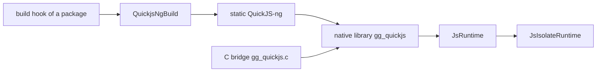

<!--
@license
Copyright (c) ggsuite

Use of this source code is governed by terms that can be
found in the LICENSE file in the root of this package.
-->

# QuickJS-ng for build hooks and Dart

## Motivation

- Native packages that embed a JavaScript engine each need its C sources.
  `gg_quickjs` 0.1.0 holds QuickJS-ng 0.17.0 once and compiles it in the
  build hook of any package, so that no package copies the engine.
- Dart code wants to run scripts with real values: numbers, maps, typed
  data, promises as futures, errors as typed exceptions, not strings.
- An app that runs scripts needs a sandbox it can trust by default: no
  files, no network, no timers and no console until Dart grants them.

## Strategy

- Ship the library subset of QuickJS-ng unchanged and offer a hook helper
  that builds it as a static library with hidden symbols.
- Build the package's own native library the same way, plus a small C
  bridge, so that the helper is used in production by its own author.
- Exchange values in a compact binary encoding; keep objects that should
  stay in JavaScript as handles.
- Offer the same API synchronously and on a worker isolate.
- Make every capability an explicit grant in `JsRuntimeOptions`.

## QuickJS-ng as sources for build hooks

- `src/quickjs-ng` holds the core engine without `quickjs-libc`, so the
  engine itself has no file, network or process access.
- `package:gg_quickjs/hook.dart` exports `QuickjsNgBuild`: `run` compiles
  the static library, and the helper names the sources, the defines and
  the flags per platform for builds of one's own.
- Hidden symbols let several native libraries of one app link their own
  copy without a clash.
- `tool/update-quickjs-ng.js` copies the subset of a new tag and sets
  `quickjsNgVersion`; `NOTICE` carries the license of QuickJS-ng.

## The C bridge and the native library

- `hook/build.dart` links `src/gg_quickjs.c` with QuickJS-ng into the
  native asset `gg_quickjs`; `hook/link.dart` drops it from a release
  build that never creates a runtime.
- The bridge enforces the memory limit in its allocator, the timeout and
  `interrupt()` through the interrupt handler of QuickJS-ng, and runs the
  pending jobs after every call.
- A conversion to Dart keeps to the same limits, so a sparse array or a
  value of repeated references cannot outgrow them.

## The Dart binding

- `JsRuntime` evaluates scripts, modules and bytecode, calls functions
  and reads and writes globals with Dart values in both directions.
- Dart functions become JavaScript functions; a `Future` becomes a
  promise and a promise a `Future`.
- `JsValue` handles keep objects in JavaScript; `withJsValues` releases a
  scope of them, and handles freed during a call wait until it returns.
- Errors arrive as the sealed `JsException`, e.g. `JsTypeError`,
  `JsInterruptedError` or `JsOutOfMemoryError`, with line and column.

## The isolate runtime

- `JsRuntime.spawn()` returns a `JsIsolateRuntime`: a worker isolate owns
  the runtime, every method returns a future and values cross as copies.
- Registered functions run on the calling isolate; JavaScript receives a
  promise of their result.
- `interrupt()` sets a flag of the native runtime and stops a busy worker;
  `dispose()` interrupts the calls in flight, `graceful: true` waits.

## The sandbox, closed by default

- `console`, the timers, `fetch` and `fs` exist only when
  `JsRuntimeOptions` grants them; there is no `std` or `os` module.
- `fs` reaches only absolute paths below its roots, with `..` and links
  resolved before the check.
- `fetch` reaches only the allowed hosts, checks every redirect, drops
  headers such as `Host` and refuses a response beyond the memory limit.

## Open Points

- The sandbox is a capability policy, not a defense against hostile code;
  run untrusted code in a separate process.
- `eval` in a script that used up its memory may crash QuickJS-ng 0.17.0.
- An interrupt of the isolate runtime reaches only a call that runs.
- No web support.
