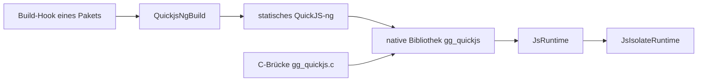

<!--
@license
Copyright (c) ggsuite

Use of this source code is governed by terms that can be
found in the LICENSE file in the root of this package.
-->

# QuickJS-ng für Build-Hooks und Dart

## Motivation

- Native Pakete, die eine JavaScript-Engine einbetten, brauchen jeweils
  deren C-Quellen. `gg_quickjs` 0.1.0 hält QuickJS-ng 0.17.0 einmal vor
  und kompiliert es im Build-Hook jedes Pakets, sodass keines die Engine
  kopiert.
- Dart-Code will Skripte mit echten Werten ausführen: Zahlen, Maps, typed
  data, Promises als Futures, Fehler als typisierte Exceptions, keine
  Strings.
- Eine App, die Skripte ausführt, braucht eine Sandbox, der sie von Haus
  aus trauen kann: keine Dateien, kein Netz, keine Timer und keine Konsole,
  bis Dart sie gewährt.

## Strategie

- Die Bibliotheksauswahl von QuickJS-ng unverändert ausliefern und einen
  Hook-Helfer anbieten, der sie als statische Bibliothek mit verborgenen
  Symbolen baut.
- Die eigene native Bibliothek des Pakets genauso bauen, plus eine kleine
  C-Brücke, sodass der Helfer schon beim eigenen Autor im Einsatz ist.
- Werte in einer kompakten Binärkodierung austauschen; Objekte, die in
  JavaScript bleiben sollen, als Handles halten.
- Dieselbe API synchron und auf einem Worker-Isolate anbieten.
- Jede Fähigkeit zu einer ausdrücklichen Freigabe in `JsRuntimeOptions`
  machen.

## QuickJS-ng als Quellen für Build-Hooks

- `src/quickjs-ng` enthält die Kern-Engine ohne `quickjs-libc`, die Engine
  selbst erreicht also weder Dateien noch Netz noch Prozesse.
- `package:gg_quickjs/hook.dart` exportiert `QuickjsNgBuild`: `run`
  kompiliert die statische Bibliothek, und der Helfer nennt Quellen,
  Defines und Flags je Plattform für eigene Builds.
- Verborgene Symbole lassen mehrere native Bibliotheken einer App je ihre
  eigene Kopie linken, ohne dass sie kollidieren.
- `tool/update-quickjs-ng.js` kopiert die Auswahl eines neuen Tags und
  setzt `quickjsNgVersion`; `NOTICE` trägt die Lizenz von QuickJS-ng.

## Die C-Brücke und die native Bibliothek

- `hook/build.dart` linkt `src/gg_quickjs.c` mit QuickJS-ng zum nativen
  Asset `gg_quickjs`; `hook/link.dart` lässt es in einem Release-Build weg,
  der nie eine Runtime erzeugt.
- Die Brücke setzt das Speicherlimit in ihrem Allokator durch, Timeout und
  `interrupt()` über den Interrupt-Handler von QuickJS-ng, und führt nach
  jedem Aufruf die ausstehenden Jobs aus.
- Die Umwandlung nach Dart hält dieselben Grenzen ein, sodass ein dünn
  besetztes Array oder ein Wert aus wiederholten Referenzen sie nicht
  sprengt.

## Die Dart-Anbindung

- `JsRuntime` wertet Skripte, Module und Bytecode aus, ruft Funktionen auf
  und liest und schreibt Globale mit Dart-Werten in beide Richtungen.
- Dart-Funktionen werden zu JavaScript-Funktionen; ein `Future` wird zur
  Promise und eine Promise zum `Future`.
- `JsValue`-Handles halten Objekte in JavaScript; `withJsValues` gibt
  einen Bereich davon frei, und während eines Aufrufs freigegebene Handles
  warten, bis er zurückkehrt.
- Fehler kommen als versiegelte `JsException` an, etwa `JsTypeError`,
  `JsInterruptedError` oder `JsOutOfMemoryError`, mit Zeile und Spalte.

## Die Isolate-Runtime

- `JsRuntime.spawn()` liefert eine `JsIsolateRuntime`: Ein Worker-Isolate
  besitzt die Runtime, jede Methode liefert ein Future und Werte gehen als
  Kopien hinüber.
- Registrierte Funktionen laufen auf dem aufrufenden Isolate; JavaScript
  erhält eine Promise ihres Ergebnisses.
- `interrupt()` setzt ein Flag der nativen Runtime und stoppt einen
  beschäftigten Worker; `dispose()` unterbricht laufende Aufrufe,
  `graceful: true` wartet auf sie.

## Die Sandbox, von Haus aus geschlossen

- `console`, die Timer, `fetch` und `fs` gibt es nur, wenn
  `JsRuntimeOptions` sie gewährt; es gibt kein `std`- oder `os`-Modul.
- `fs` erreicht nur absolute Pfade unterhalb seiner Wurzeln, mit `..` und
  Links vor der Prüfung aufgelöst.
- `fetch` erreicht nur erlaubte Hosts, prüft jede Weiterleitung, verwirft
  Header wie `Host` und lehnt eine Antwort über dem Speicherlimit ab.

## Offene Punkte

- Die Sandbox ist eine Fähigkeiten-Policy, kein Schutz vor feindlichem
  Code; nicht vertrauenswürdigen Code in einem eigenen Prozess ausführen.
- `eval` in einem Skript, das seinen Speicher aufgebraucht hat, kann
  QuickJS-ng 0.17.0 abstürzen lassen.
- Ein Interrupt der Isolate-Runtime erreicht nur einen laufenden Aufruf.
- Keine Web-Unterstützung.
